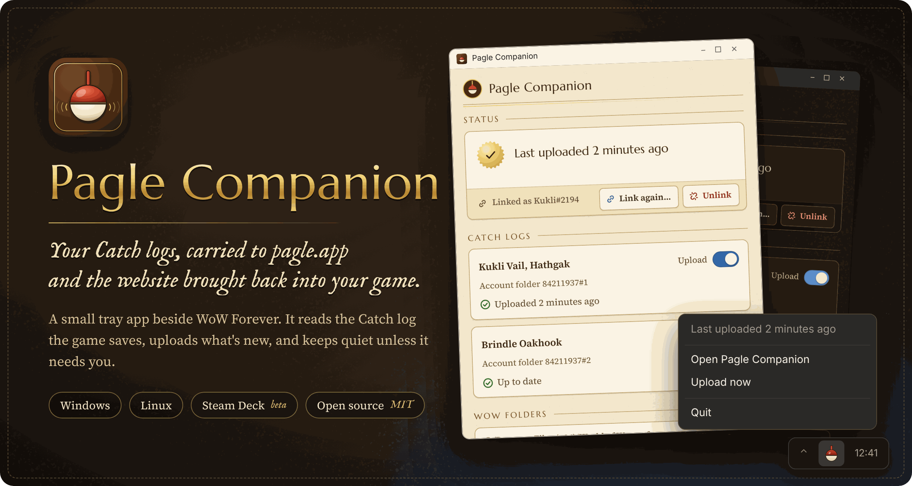
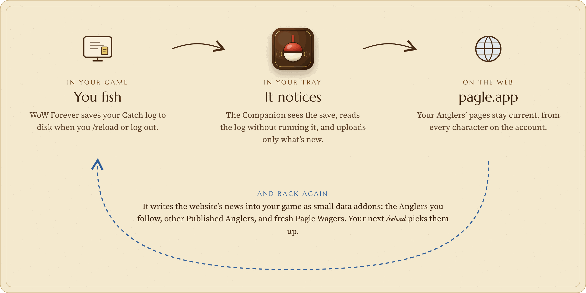
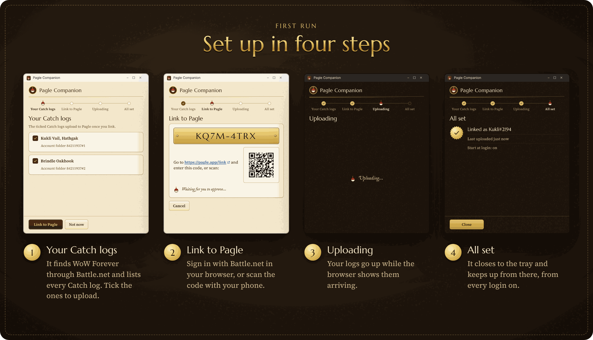
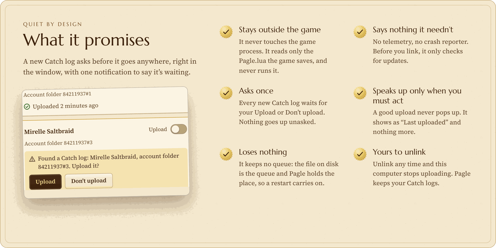
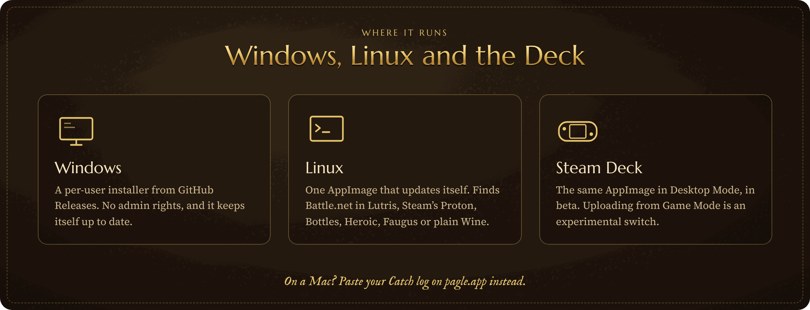

# pagle-companion

<p align="center">
  
</p>

<p align="center">
  <a href="https://pagle.app/download"><b>Download</b></a> ·
  <a href="https://github.com/timemir/pagle-companion/releases/latest">Latest release</a>
</p>

The Pagle Companion is a small tray app that runs beside WoW Forever. When the game saves your Catch log, the Companion reads it, without ever running it, and uploads only what's new to [pagle.app](https://pagle.app). It also brings the website back into your game as small data addons: the Anglers you follow, other Published Anglers, and fresh Pagle Wagers.









It runs on Windows and Linux. **Steam Deck support is beta**, and **uploading in Game Mode is experimental**: neither has been tested on a Deck yet. See [Steam Deck testing](#steam-deck-testing).

If a local backup falls behind or disagrees with Accepted history, choose **Prepare Recovery** in the Catch logs list. Recovery preserves your original branch and stages a signed data addon in the selected WoW installation. Return to character selection for a newly installed folder; if WoW already knows the folder, use `/reload`. After the addon applies Recovery and the game saves, use **Upload now** to check consistency.

On a Mac, use the addon's Paste string and the website's manual Recovery download. The website walks you through the same restoration and follow-up Upload without a Companion.

## Steam Deck testing

If you have a Steam Deck, please [file a Steam Deck report](https://github.com/timemir/pagle-companion/issues/new?template=steam-deck-report.yml). The "Keep uploading in Game Mode" toggle links to the same form.

The developer has no Deck, so the labels come off only on testers' reports:

- **A good report** answers "yes" to every check of a label. For **Steam Deck (beta)**: in Desktop Mode the Companion starts, its tray icon shows and linking works. For **Game Mode (experimental)**: with the toggle on, the unit survives a reboot and an Upload arrives after a logout in Game Mode. The developer marks it `deck-good`, `game-mode-good` or both.
- **A label comes off** after 2 good reports from different GitHub accounts, none the developer's, on the current Stable SteamOS (same major and minor version). Taking it off changes three places: the Operator switches off the website's setting (`pagle.download.steam-deck-beta` or `pagle.download.game-mode-experimental`), and the toggle's label and this README change in the next Release.
- **A label goes back on** when an outside tester on the current Stable version answers "no" to one of its checks; the developer marks that report `deck-broken` or `game-mode-broken`. It comes off again only with new good reports on that Stable version.

## Development

The Companion is a [Tauri 2](https://v2.tauri.app/) tray app: a Rust core in `src-tauri/` and a small web UI in `ui/`, served as static files.

You need Rust (stable), Node.js LTS and [Tauri's prerequisites](https://v2.tauri.app/start/prerequisites/) for your platform: the MSVC build tools and WebView2 on Windows, or WebKitGTK 4.1, libayatana-appindicator, librsvg and libxdo on Linux.

```sh
npm ci                   # the Tauri CLI
npm run tauri dev        # run the tray app in development
cd src-tauri
cargo test               # every test cites the CMP or DST rule it checks
cargo clippy --all-targets -- -D warnings
cargo fmt --check
```

A debug build talks to `PAGLE_COMPANION_BASE_URL` when it is set, for a local backend; release builds always talk to `https://pagle.app`.

Tester packages come from the **Test build** workflow, started by hand on any branch.

`tauri.conf.json` sets `bundle.createUpdaterArtifacts`, so a local `npx tauri build` needs the updater signing key in `TAURI_SIGNING_PRIVATE_KEY` (and its password in `TAURI_SIGNING_PRIVATE_KEY_PASSWORD`), or the tester builds' overlay, which turns the signatures off:

```sh
npx tauri build --config '{"bundle":{"createUpdaterArtifacts":false}}'
```

The release workflow's scripts in `ci/` have their own tests: `bash ci/test.sh` (needs git, jq and minisign).

## Releasing

A Release is published by `.github/workflows/release.yml` from an annotated version tag. A published Release is permanent: it is never edited or deleted, and a broken one is fixed forward.

1. Set the same `MAJOR.MINOR.PATCH` version, higher than the latest Release's and without a suffix, in `src-tauri/tauri.conf.json` and `src-tauri/Cargo.toml`, and merge that to `main`.
2. Tag that commit with the release notes as the tag's message. They become the Release's body and the updater's notes, and are final once pushed:

   ```sh
   git tag -a v1.2.3 -m "<release notes>"
   git push origin v1.2.3
   ```

The workflow checks the tag, builds both packages into a draft, verifies their updater signatures, writes `latest.json` and only then publishes.

**A failed run.** If `check` failed, fix the cause, delete the tag (`git push --delete origin v1.2.3`, `git tag -d v1.2.3`) and tag again. If `draft`, `build-windows` or `build-linux` failed, delete the draft Release and the tag, then push the tag again. Only `publish` and `winget` may be re-run in place.

**Procedures** in the spec:
- Defender flags a Release: submit it as a false positive.
- The updater key leaks.
- Raising the minimum Companion version.

## Security

Report a vulnerability privately, never in a public issue: see [SECURITY.md](SECURITY.md), which also says how to check a download's signature.

## Licence

The Companion is MIT-licensed. See [LICENSE](LICENSE).
